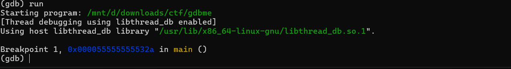
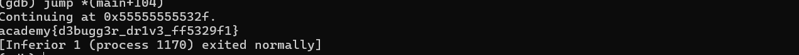

# picoCTF 2022 - GDB Test Drive (Reverse Engineering)

## Challenge Metadata
- **category:** Reverse Engineering
- **Difficulty:** Medium
- **Description:** Can you get the flag?
Here's the test drive instructions:
```bash
$ chmod +x gdbme
$ gdb gdbme
(gdb) layout asm
(gdb) break *(main+99)
(gdb) run
(gdb) jump *(main+104)
```

---

## Summary

- **Given file:** binary (ELF shared library)
- just follow the given instructions

---

## Initial Steps

- check file

```bash
file gbdme

gdbme: ELF 64-bit LSB pie executable, x86-64, version 1 (SYSV), dynamically linked, interpreter /lib64/ld-linux-x86-64.so.2, BuildID[sha1]=eff8566ca2ba5ffda2ccb28991ee00593bd1a923, for GNU/Linux 3.2.0, not stripped
```

## Procedure

```bash
chmod +x gdbme
gdb gdbme
```

```bash

(gdb) layout asm
(gdb) break *(main+99)
breakpoint1 at 0x132a
(gdb) run
```


```bash
(gdb) jump *(main+104)

```



## FLAG

flag of the challenge is academy **{d3bugg3r_dr1v3_ff5329f1}**