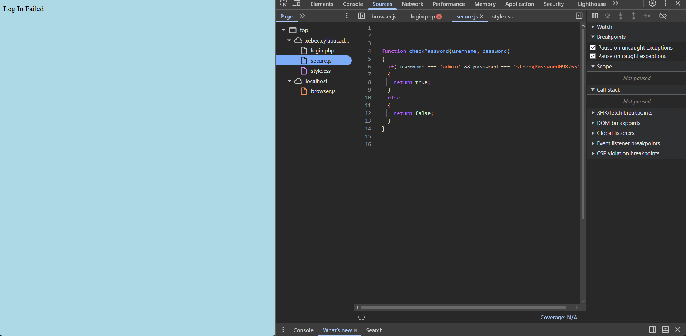

# picoCTF 2022 - Local Authority (Web Exploitation
)

## Challenge Metadata
- **category:** Web Exploitation
- **Difficulty:** Easy
- **Description:** Can you get the flag? (instance launcher is also given)

---

## Summary
- solution was easily found in the **devloper's view**.

## Initial Steps
- Launching the instance and going to **[http://xebec.cylabacademy.net:36665](URL)**

- Typing random credentials

---
## Procedure
- going to **developer's view**
- checking **Sources**
- checking browser.js for password, username, flag: Nothing found
- checking Secure.js

- BINGO! found the credentials
- entering the credentials and......

## FLAG
 Flag of the challenge is **academy{j5_15_7r4n5p4r3n7_4fcce45f}**