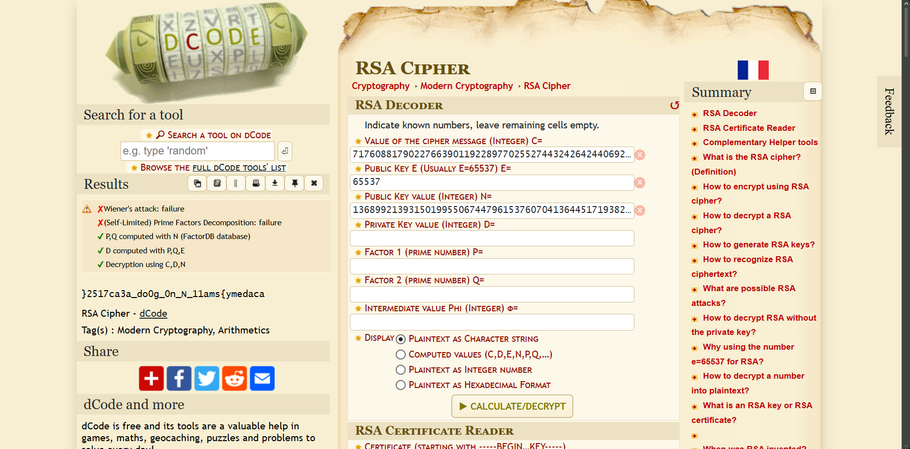

# picoCTF 2021 - Mind your Ps and Qs (cryptography)

## Challenge Metadata
- **category:** Cryptography
- **Difficulty:** Medium
- **Description:** In RSA, a small e value can be problematic, but what about N?

---

## Summary
- it was a RSA decode challenge

---

## Initial Steps
- **values** file was given with the challenge
- **File type:** 
```bash
file values

values: ASCII text
```
- reading the file
```bash 

cat values

Decrypt my super sick RSA:
c: 717608817902276639011922897702552744324264244069272484013719744328086856277690292
n: 1368992139315019955067447961537607041364451719382349005056752379702694554965203011
e: 65537
```

## Procedure

- I don't know how to do this with python so just used this website: **[https://www.dcode.fr/rsa-cipher](URL)**

- 

- we got **}2517ca3a_do0g_0n_N_11ams{ymedaca**

- **Rversing** the text
```bash
echo '}2517ca3a_do0g_0n_N_11ams{ymedaca' | rev

academy{sma11_N_n0_g0od_a3ac7152}
```
## FLAG

- flag of the challenge is **academy{sma11_N_n0_g0od_a3ac7152}**

